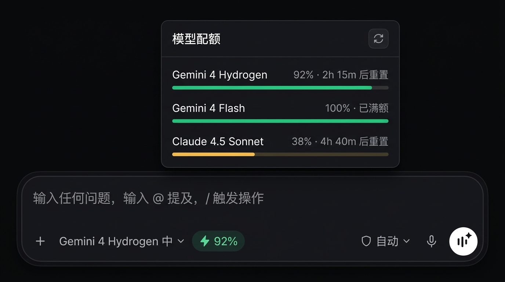

# Antigravity Quota Viewer

为 Google Antigravity 桌面客户端聊天输入框内嵌**实时配额查看器**的轻量补丁工具。



## 功能特性

- **输入框内嵌胶囊**：在聊天输入框底部模型选择器右侧显示当前配额池的 **5 小时限额**剩余百分比（`⚡ xx%`），随剩余额度自动切换绿（>50%）/ 黄（20%–50%）/ 红（<20%）状态色。
- **统一配额池弹窗**：点击胶囊向上弹出面板，清晰展示：
  - **Gemini 模型**：`5 小时限额`、`每周限额`（含进度条与重置倒计时）
  - **Claude 与 GPT 模型**：`5 小时限额`、`每周限额`（含进度条与重置倒计时）
- **低侵入且兼容汉化**：通过向 `resources/app.asar` 的 `dist/ipcHandlers.js` 与 `dist/preload.js` 注入只读本地 RPC 查询（`RetrieveUserQuotaSummary`）与前端组件实现，兼容原版客户端及 [Antigravity-Chinese-Localization](https://github.com/antigravity-cn-community/Antigravity-Chinese-Localization) 汉化包。
- **自动备份与一键还原**：首次运行自动备份原版 `app.asar.bak`，支持随时通过 `--restore` 恢复。

## 使用方法（Windows）

> **前置要求**：Python 3.8+（可选安装 Node.js 用于打包前语法校验）。

1. **完全退出 Antigravity 客户端**（确保没有残留进程占用 `resources/app.asar`）。
2. 运行补丁脚本：
   ```bash
   python patch_quota_viewer.py
   ```
   若你的 Antigravity 安装在自定义路径，可通过 `--asar` 指定：
   ```bash
   python patch_quota_viewer.py --asar "D:\Path\To\antigravity\resources\app.asar"
   ```
3. 重新启动 Antigravity 即可在聊天输入框工具栏看到 `⚡ xx%` 胶囊。

### 还原原版

退出 Antigravity 客户端后执行：

```bash
python patch_quota_viewer.py --restore
```

## 注意事项

- 客户端官方更新后会覆盖 `resources/app.asar`，更新后重新运行一次 `python patch_quota_viewer.py` 即可（若使用了第三方汉化补丁，请先更新汉化包再运行本脚本）。
- 本工具仅在本地通过 Electron 主进程向本地 Language Server（`127.0.0.1`）发起只读的 `RetrieveUserQuotaSummary` 请求，不上传或收集任何账号信息。

## License

[MIT](LICENSE)
